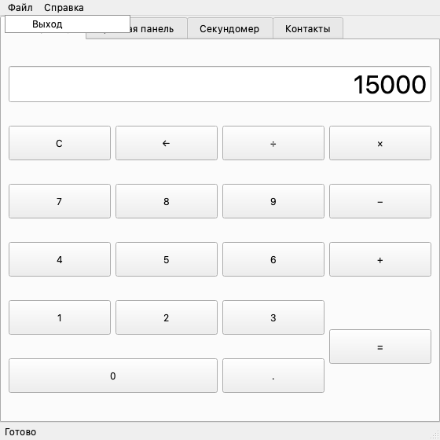
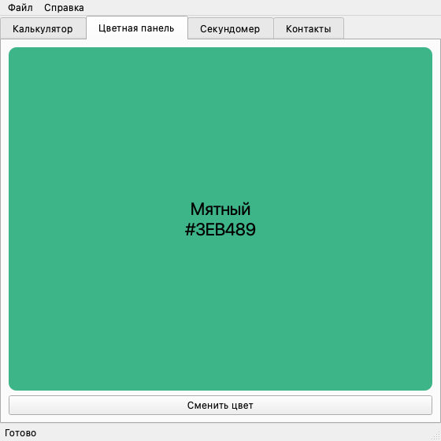
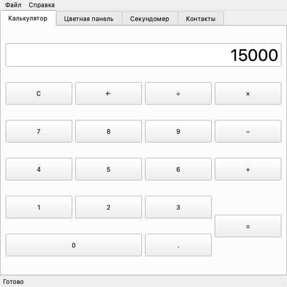
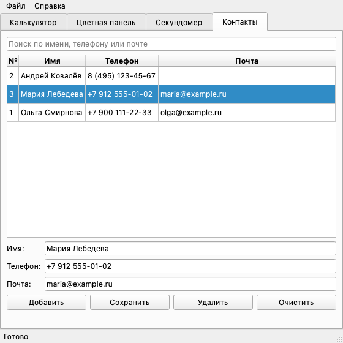
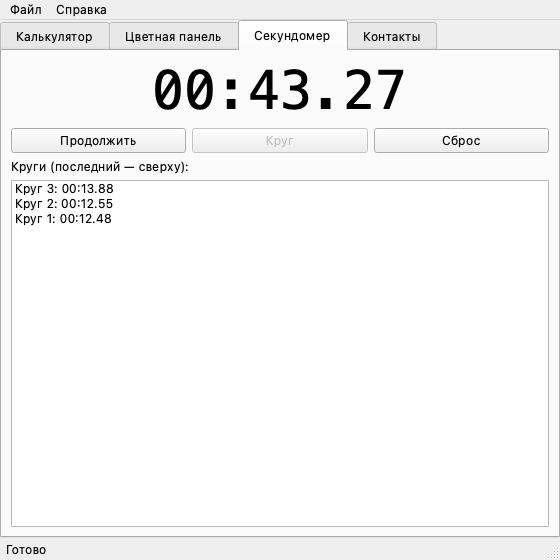

# Лабораторная работа №5 — графический интерфейс

**Фадеев Иван Александрович, группа 221141, вариант 7, лабораторная №5**

Дисциплина: «Методы и технологии программирования» (часть 1).

## Задания варианта 7

| № | Сложность | Задание из общего списка | Где в коде |
|---|-----------|--------------------------|------------|
| 1 | средняя | 7. Окно с меню (File→Exit) | `gui_lab/widgets/main_window.py` — `MainWindow` |
| 2 | средняя | 9. Цветная панель — меняет цвет по кнопке | `gui_lab/widgets/color_panel.py`, `gui_lab/colors.py` |
| 3 | средняя | 3. Простейший калькулятор | `gui_lab/widgets/calculator_tab.py`, `gui_lab/calculator.py` |
| 4 | повышенная | 7. GUI для работы с SQLite | `gui_lab/widgets/contacts_tab.py`, `gui_lab/contacts_db.py` |
| 5 | повышенная | 5. Программа таймер/секундомер | `gui_lab/widgets/stopwatch_tab.py`, `gui_lab/stopwatch.py` |

Все задания собраны в одно приложение: главное окно с меню, а в нём
вкладки «Калькулятор», «Цветная панель», «Секундомер» и «Контакты».

Интерфейс написан на **PyQt6** — актуальной версии PyQt из методички.
API тот же, что у PyQt5; отличия — полные имена перечислений
(`Qt.AlignmentFlag.AlignCenter` вместо `Qt.AlignCenter`) и `exec()`
вместо `exec_()`.

## Элементы интерфейса из методички

| Из методички | Что использовано |
|--------------|------------------|
| `QApplication`, `QWidget`, цикл событий (`mainloop`) | `QApplication` и `app.exec()` в `main.py`, все вкладки — наследники `QWidget`, окно — `QMainWindow` |
| Button | `QPushButton` — кнопки калькулятора, «Сменить цвет», «Старт/Пауза», «Добавить» и др. |
| Label | `QLabel` — табло секундомера, подпись цвета, строка состояния |
| Entry | `QLineEdit` — экран калькулятора, поля формы и поиска контактов |
| Frame | `QFrame` — цветная панель |
| Layout | `QVBoxLayout`, `QHBoxLayout`, `QGridLayout` (кнопки калькулятора), `QFormLayout` (форма контакта) |
| Обработчики событий | сигналы `clicked`, `triggered`, `textChanged`, `itemSelectionChanged`, `QTimer.timeout` и переопределённый `keyPressEvent` |

## Структура проекта

```
main.py                            запуск приложения (argparse, --version, --db)
gui_lab/calculator.py              логика калькулятора (Decimal)
gui_lab/colors.py                  палитра и контрастный цвет текста
gui_lab/stopwatch.py               логика секундомера и формат времени
gui_lab/contacts_db.py             телефонная книга в SQLite
gui_lab/widgets/main_window.py     главное окно с меню «Файл → Выход»
gui_lab/widgets/calculator_tab.py  вкладка калькулятора
gui_lab/widgets/color_panel.py     вкладка цветной панели
gui_lab/widgets/stopwatch_tab.py   вкладка секундомера
gui_lab/widgets/contacts_tab.py    вкладка «Контакты»
screenshots.py                     создание скриншотов для README
tests/                             тесты логики и виджетов (pytest)
```

Логика каждого задания вынесена в модуль без зависимостей от Qt, а
виджеты только передают ей нажатия и показывают результат. Поэтому
логику можно проверить обычными тестами, а виджеты — тестами с
программными нажатиями `QTest`.

## Запуск

```bash
python3 -m venv .venv
source .venv/bin/activate          # Windows: .venv\Scripts\activate
pip install -r requirements.txt
python main.py                     # контакты хранятся в contacts.db
python main.py --db other.db       # другой файл базы
python main.py --version
```

## Отчёт о выполнении

### Задание 7 (средней сложности): окно с меню File → Exit

`MainWindow` — наследник `QMainWindow` со строкой меню: «Файл → Выход»
и «Справка → О программе». Пункт «Выход» — это `QAction` с сочетанием
клавиш `Ctrl+Q` (`Cmd+Q` на macOS), его сигнал `triggered` подключён к
`close()`. Меню встроено в окно (`setNativeMenuBar(False)`), поэтому и
на macOS оно находится в окне, а не в системной строке меню.



### Задание 9 (средней сложности): цветная панель

Кнопка «Сменить цвет» перекрашивает панель (`QFrame`) в следующий цвет
палитры по кругу. Подпись с названием и кодом цвета становится чёрной
или белой — функция `text_color_for` считает относительную яркость
фона по формуле WCAG и выбирает более читаемый вариант.



### Задание 3 (средней сложности): простейший калькулятор

Логика — класс `Calculator`, который работает как карманный
калькулятор: операции выполняются сразу слева направо (`2 + 3 × 4 =`
даёт `20`), повторное нажатие операции заменяет её, `C` сбрасывает
всё, `←` стирает последний символ. Числа хранятся в `Decimal`, поэтому
`0.1 + 0.2 = 0.3`; `1 ÷ 3` округляется до 10 знаков. Деление на ноль
показывает «Ошибка», и следующая клавиша начинает работу заново.
`eval` не используется — выражение не собирается в строку.

Вкладка — сетка `QPushButton` в `QGridLayout`; кроме кнопок работает
ввод с клавиатуры через `keyPressEvent`: цифры, `+ - * /`, `Enter`,
`Backspace`, `Esc`. На скриншоте посчитано `1250 × 12 =`.



### Задание 7 (повышенной сложности): GUI для работы с SQLite

`ContactsDB` хранит телефонную книгу в файле SQLite (таблица
`contacts`): добавление, изменение, удаление, получение по `id` и
поиск. Все запросы параметризованы (`?`), поэтому кавычки во вводе не
ломают SQL — это проверяет тест с именем `Robert'); DROP TABLE
contacts;--`. Ввод проверяется: имя обязательно, телефон — цифры
`0–9`, пробелы, скобки, дефис и `+`, не меньше пяти цифр; почта
необязательна, но с `@`.

Вкладка «Контакты» — интерфейс ко всем этим операциям:

- таблица `QTableWidget` с записями из базы, поле поиска фильтрует её
  по мере ввода (сигнал `textChanged`);
- выбор строки заполняет форму, кнопка «Сохранить» записывает
  изменения;
- «Добавить» создаёт контакт из формы, «Удалить» спрашивает
  подтверждение;
- ошибки ввода показываются под формой красным, успешные операции —
  зелёным.

Данные сохраняются между запусками в `contacts.db` (файл в
`.gitignore`).



### Задание 5 (повышенной сложности): секундомер

`Stopwatch` считает время по `time.monotonic` — эти часы не сбиваются
при переводе системного времени. Поддерживаются пауза с продолжением,
круги и сброс. Табло обновляет `QTimer` примерно 30 раз в секунду, но
само время берётся из `Stopwatch`, поэтому задержки таймера на
точность не влияют. Круги выводятся списком, последний — сверху.
Кнопка «Круг» доступна только во время отсчёта, а «Старт» меняет
подпись на «Пауза» и «Продолжить».



## Тесты

Тесты запускаются без показа окон: `tests/conftest.py` создаёт
приложение Qt в режиме `offscreen`. Логика проверяется напрямую,
виджеты — программными нажатиями кнопок и клавиш через `QTest`.
Секундомер в тестах работает на «ручных» часах, база — в памяти.

```console
$ pip install -r requirements-dev.txt
$ python -m pytest -q
........................................................................ [ 88%]
.........                                                                [100%]
81 passed in 0.19s
```

| Файл | Тестов |
|------|--------|
| `test_app.py` | 2 |
| `test_calculator.py` | 20 |
| `test_calculator_tab.py` | 4 |
| `test_color_panel.py` | 4 |
| `test_colors.py` | 9 |
| `test_contacts_db.py` | 16 |
| `test_contacts_tab.py` | 7 |
| `test_main_window.py` | 4 |
| `test_stopwatch.py` | 11 |
| `test_stopwatch_tab.py` | 4 |

Скриншоты в README сделаны скриптом `screenshots.py` тем же
offscreen-режимом:

```bash
QT_QPA_PLATFORM=offscreen python screenshots.py
```

```console
$ python main.py --version
lab5 1.0.0
```
